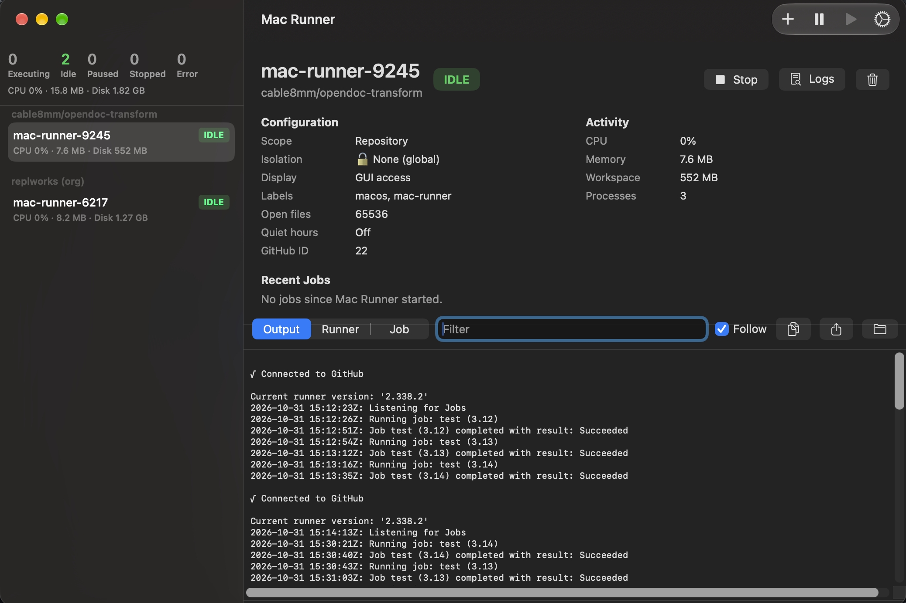

맥북을 GitHub Actions 셀프호스티드 러너로 돌리는데 CI가 유독 느렸습니다. 로그를 보니 매번 2GB짜리 캐시를 다운로드하고 있더군요. 러너가 내 맥북인데 캐시를 왜 네트워크로 받아오는지 이해가 안 됐습니다.

원인은 [`actions/setup-node`](https://github.com/actions/setup-node)의 `cache: "npm"` 한 줄이었습니다. 이 줄을 지웠더니 4분대가 26초가 됐습니다.

## 셀프호스티드 러너를 쓰는 이유

먼저 왜 셀프호스티드 러너를 쓰는지부터 정리하겠습니다. 이유는 두 가지입니다.

### 1. private 저장소 한도와 macOS 단가

public 저장소는 표준 호스티드 러너가 무료입니다. 하지만 private은 플랜별로 월 포함 사용량이 있고, 지금은 분이 아니라 금액 기준입니다. GitHub Free는 월 $12, Pro와 Team은 월 $18입니다. [러너를 쓴 시간만큼 단가를 곱해서 이 금액에서 차감](https://docs.github.com/en/billing/concepts/product-billing/github-actions)합니다.

문제는 macOS 단가입니다. Linux 2코어는 분당 $0.006인데 [macOS는 $0.062로 약 10배](https://docs.github.com/en/billing/reference/actions-runner-pricing) 입니다. 같은 금액으로 Linux는 Free 2,000분, Pro 3,000분을 쓰지만, 전부 macOS에 쓴다고 치면 Free는 약 190분, Pro는 약 290분이 한계입니다. 맥 이미지가 필요한 프로젝트는 금방 바닥납니다.

### 2. macOS 인스턴스 대기 시간

GitHub에서 macOS 이미지를 띄우고 러너가 시작될 때까지 기다리는 시간이 길었습니다. 제 경우엔 많게는 30분까지 걸렸습니다. CI는 몇십 초면 끝나는데 시작을 기다리는 시간이 더 길었던 겁니다.

그래서 private 환경이나 macOS 이미지가 필요한 러너를 내 개발 머신에서 돌리기로 했습니다. 커밋은 내가 작업할 때만 하니까 24시간 켜둘 필요도 없었습니다. 필요하면 맥북을 켜두면 됩니다. 셀프호스티드 러너는 지금 GitHub에서 무료이기도 하고요. (위 billing 문서에 셀프호스티드 러너는 무료로 명시돼 있습니다.)

## 증상

그런데 옮기고 나니 CI가 오히려 느렸습니다. 쓰던 `ci.yml`은 이렇습니다.

```yaml
name: CI Pipeline

on:
  push:
    branches: [main, develop]
  pull_request:
    branches: [main, develop]

jobs:
  continuous-integration:
    runs-on: [self-hosted, macos, arm64]

    steps:
      - name: Checkout Code
        uses: actions/checkout@v7

      - name: Setup Node.js
        uses: actions/setup-node@v7
        with:
          node-version: "24"
          cache: "npm"

      - name: Install Dependencies
        run: npm ci

      - name: Check Code Quality & Formatting
        run: |
          npm run lint
          npm run format:check

      - name: Build Astro site
        run: npm run build
        env:
          NODE_ENV: production

      - name: Check build output
        run: ls -la dist
```

`runs-on`이 `self-hosted`인데도 실행할 때마다 캐시 복원 단계에서 2GB를 내려받았습니다. 실행 시간은 이랬습니다.

| 구분                          | 실행 시간                     |
| ----------------------------- | ----------------------------- |
| 셀프호스티드 + `cache: "npm"` | 4분 16초, 4분, 53초, 4분 19초 |
| GitHub 호스티드 러너 (참고)   | 26초, 23초, 29초              |

내 맥북이 호스티드 러너보다 열 배 가까이 느렸습니다.

## 원인

`cache: "npm"`은 로컬 디스크의 `~/.npm`을 그대로 쓰는 옵션이 아닙니다. setup-node의 캐시 기능은 내부적으로 `actions/cache`를 씁니다. ([setup-node README](https://github.com/actions/setup-node)) 그리고 GitHub 문서에 따르면 셀프호스티드 러너를 쓸 때도 [캐시는 **GitHub가 소유한 클라우드 저장소**에 저장](https://docs.github.com/en/actions/writing-workflows/choosing-what-your-workflow-does/caching-dependencies-to-speed-up-workflows)됩니다.

그러니까 job이 끝나면 `~/.npm`을 서버에 올리고, 다음 job이 시작될 때 서버에서 다시 내려받아 복원합니다. 로컬 디스크에 캐시가 멀쩡히 있어도 매번 2GB를 네트워크로 주고받는 겁니다. 내 인터넷 회선으로 GitHub 서버와 통신하니 호스티드 러너보다 느릴 수밖에 없습니다.

## 해결



`cache: "npm"` 줄을 지웠습니다.

```yaml
- name: Setup Node.js
  uses: actions/setup-node@v7
  with:
    node-version: "24"
```

셀프호스티드 러너는 작업 폴더와 홈 디렉토리가 job 사이에도 그대로 유지됩니다. `~/.npm`이 맥북에 남아 있으니 `npm ci`가 로컬 캐시에서 바로 설치합니다. 서버로 올렸다 내렸다 하는 과정이 통째로 사라집니다.

결과는 **26초**입니다. 호스티드 러너와 비슷한 수준이 됐습니다.

## 호스티드 러너에선 왜 필요했나

GitHub 문서에도 나와 있듯이 호스티드 러너의 job은 깨끗한 러너 이미지에서 시작해서, [의존성을 매번 새로 받아야 합니다](https://docs.github.com/en/actions/writing-workflows/choosing-what-your-workflow-does/caching-dependencies-to-speed-up-workflows). job이 끝나면 VM이 통째로 버려지니까요. 캐시가 없으면 매번 레지스트리에서 전부 새로 받아야 합니다.

`cache: "npm"`은 이걸 해결하려는 옵션입니다. job 끝에 `~/.npm`을 GitHub 캐시 저장소에 올리고, 다음 job의 새 VM에서 복원합니다. GitHub 내부 네트워크가 레지스트리보다 보통 빠르고 안정적이라 이득이 있습니다.

셀프호스티드는 반대입니다. 디스크가 이미 캐시 저장소 노릇을 하고 있습니다. 호스티드 러너 때 쓰던 워크플로를 그대로 가져오면 필요 없는 과정까지 같이 딸려옵니다.

## 적용 조건

러너를 직접 설치해서 상시 돌리는 경우 얘기입니다. 아래 경우는 `~/.npm`이 job마다 초기화돼서 오히려 캐시가 필요할 수 있습니다.

- ephemeral 모드로 러너를 띄우는 경우
- 컨테이너 안에서 러너를 돌리는 경우
- 여러 러너가 홈 디렉토리를 공유하지 않는 경우

## 덤으로 볼 것들

- **`npm ci --prefer-offline`**: 로컬 캐시를 우선 쓰고 레지스트리 조회를 줄입니다.
- **`node_modules`는 매번 삭제됩니다**: `npm ci`는 항상 지우고 다시 설치합니다. 네트워크는 안 쓰지만 디스크 작업은 합니다.
- **Astro 빌드 캐시**: `node_modules/.astro` 같은 캐시도 같이 지워져서 매번 새로 만들어집니다.
- **2GB는 큰 편입니다**: 호스티드 러너로 돌아갈 일이 있으면 캐시에 Playwright 브라우저 같은 큰 패키지가 들어 있는지 확인해 보세요. 참고로 캐시 저장소는 저장소당 10GB까지 무료입니다.
- **셀프호스티드 요금 정책**: GitHub가 2025년 12월에 private 저장소의 셀프호스티드 러너에 분당 $0.002를 부과하겠다고 발표했다가, [반발로 보류](https://www.theregister.com/2025/12/17/github_charge_dev_own_hardware/)했습니다.

## 정리

- private 한도, macOS 단가, 긴 대기 시간 때문에 맥북을 셀프호스티드 러너로 썼습니다.
- `cache: "npm"`은 로컬 디스크가 아니라 **GitHub 캐시 저장소**를 거칩니다.
- 호스티드 러너는 job마다 VM이 새로 생기니 필요하고, 셀프호스티드는 디스크가 유지되니 필요 없습니다.
- 셀프호스티드에서 이 줄을 지웠더니 CI가 **4분대에서 26초**로 줄었습니다.

호스티드 러너 때 쓰던 워크플로를 셀프호스티드로 옮겼다면 `cache` 줄부터 확인해 보세요.
